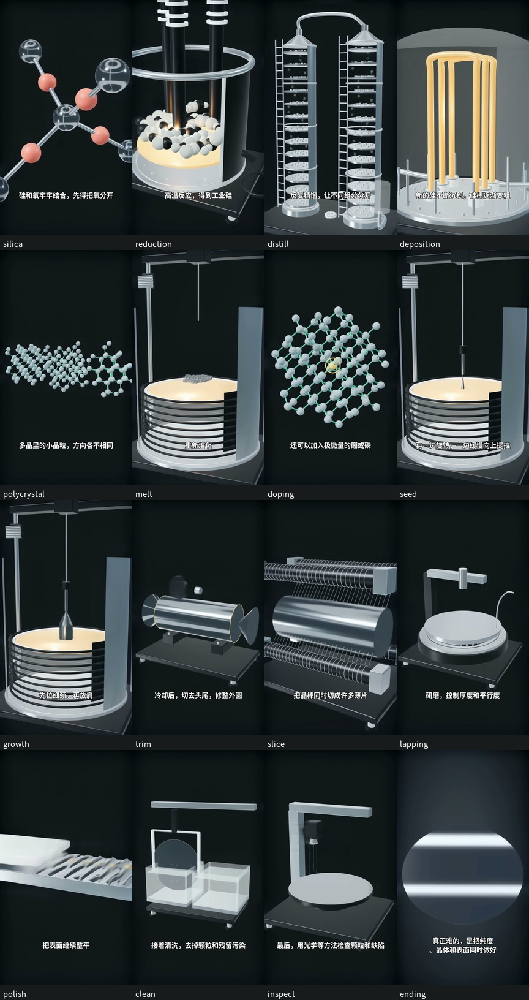

# 从石英到硅片

一条 9:16 中文科普视频，以及可以重新运行的 ComfyUI 制作工程。

影片约 2 分 54 秒，输出 1080 x 1920、24 fps。以实物照片呈现石英、晶棒、
籽晶和加工晶圆；用有明确动作的三维图解解释提纯、晶体生长、切片、研磨、
抛光、清洗与检测。文字在最后合成，照片署名放在工程和播放器外侧。

**[下载完整视频与工程包](https://github.com/theageofadzz/silicon-wafer-explainer/releases/latest)**



## 制作分工

每段先按实际录音拆出解释对象、动作、关系和结论，再由相同时间轴驱动模型、
生成镜头、字幕及音效。详见 [BEATS.md](BEATS.md)。

| 部分 | 方法 | 可复用文件 |
| --- | --- | --- |
| 真实物体 | 已署名照片 -> ComfyUI 原生 LTX 图生视频 | `assets/inputs/`、`opening/assets/v3-real/` |
| 内部结构与工序 | Three.js 精确动作参考 -> ComfyUI LTX 引导生成 | `model/scene.mjs`、`shots.json` |
| 配音与时间轴 | 实际语音 WordBoundary -> 秒 -> 段落绝对偏移 | `assets/voice/`、`timeline.json` |
| 剪辑、字幕、声音 | ComfyUI 合成节点调用 FFmpeg / Pillow | `production/assemble.py` |
| 验证 | 编码检查、时间轴、字体、字幕 OCR、连续帧 | `production/verify.py`、`review/` |

原生扩散为 576 x 1024；新增动作段每段 65 帧，按各自实际台词时长运行，
原生约 6--9 fps，合成时以运动补偿插值转换到 24 fps，再放大输出。
照片镜头原生 24 fps。1080p 是交付尺寸，不代表原生扩散就是 1080p。

AI 照片动态重建不是实拍视频。设备为教学结构示意，不是厂商工程图。
晶格配位、尺寸比例等需要准确的部分由确定性三维提供；生成后的几何仍需逐段复核。
微观尺寸和工艺耗时经过放大或压缩。事实来源及图解边界见 [FACTS.md](FACTS.md)。

## 两种入口

| 工作流 | 作用 |
| --- | --- |
| [all.json](workflows/all.json) | 重新生成开场 5 段、新增 16 段动作与 2 段实物，再合成整片 |
| [assemble-cached.json](workflows/assemble-cached.json) | 使用已生成片段，重新合成字幕、配音与完整视频 |
| `*-api.json` | 与可视化工作流对应的 ComfyUI API 版本 |

自定义节点包含准备输入、读取照片/动作参考、保存原生扩散结果、
重建已确认开场和完整合成。所有生成分支都连接到最终合成节点。

Git 仓库包含来源照片、必要输入、生成片段、配音和时间轴。
工程包另外包含成片与动作参考视频，下载后可直接运行缓存合成入口。
模型权重和 ComfyUI 运行时需要独立安装。

## 环境

- Node.js 22+，Python 3.9+，FFmpeg / FFprobe（需 `libx264`、`minterpolate`）。
- Google Chrome，或通过 `SILICON_CHROME_PATH` 指定 Chrome / Chromium 可执行文件。
- 独立的 ComfyUI，本项目实际使用版本记录在 `workflows/runtime.json`。
- Python 依赖同时安装到制作环境和 ComfyUI 的 Python 环境。
- macOS 的字幕 OCR 使用自带 Vision / Swift；其他平台保留取帧与字体检查，
  并明确报告 OCR 未运行，不能据此宣称文字验收完成。

```sh
python3 -m venv .venv
source .venv/bin/activate
pip install -r requirements.txt
npm ci

# 在 ComfyUI 自己的虚拟环境中也安装 requirements.txt 中的依赖。
```

模型下载来源、文件大小及 SHA-256 见 [workflows/models.json](workflows/models.json)。
默认目录：

```text
your-model-root/
  checkpoints/ltxv-2b-0.9.8-distilled.safetensors
  text_encoders/t5xxl_fp8_e4m3fn.safetensors
```

本机使用 Apple M4 16 GB，MPS 扩散与 BF16 VAE，T5 在 CPU。
生成需要较长时间，实际速度和可用精度取决于硬件。
CUDA 等环境可调整 `production/launch_comfy.py` 的精度参数。

## 运行

```sh
# 启动独立 ComfyUI；不会改写现有 ComfyUI 的用户配置。
python production/launch_comfy.py \
  --comfy-root /absolute/path/to/ComfyUI \
  --model-root /absolute/path/to/your-model-root \
  --port 8196

# 重新导出可视化及 API 工作流。
node production/comfy.mjs all --export-only
node production/comfy.mjs assemble-cached --export-only

# 全部重新生成；也可以在 ComfyUI 中导入 workflows/all.json 后运行。
node production/comfy.mjs all

# 复用已有片段。
node production/comfy.mjs assemble-cached

# 检查输出并打开播放器。
python production/verify.py
npm run preview
```

播放器地址为 `http://127.0.0.1:60090/watch.html`。
`SILICON_PORT` 可以指定播放器端口，`SILICON_COMFY_URL` 可以指定 ComfyUI 地址。
成片输出到 `output/silicon-wafer-explainer-9x16.mp4`。

仅生成某些镜头：

```sh
node production/comfy.mjs seed,growth --queue-only
python production/verify.py --clips
```

修改内容时，从 `script.json` 开始。重新配音会改变真实词事件和时长，需依次运行：

```sh
python production/narrate.py
python production/shot_plan.py
node production/render.mjs
node production/render.mjs --render
node production/comfy.mjs all --export-only
```

不能把旧词时间轴套在新配音上。工作流默认复用随工程附带的真实配音和词事件，
不会在没有提示的情况下重新请求语音服务。

## 工程结构

`opening/` 是已确认的 30 秒开场快照；其中旧文档只描述该段。
完整影片以本 README、根目录 `timeline.json` 和 `workflows/` 为准。
原 B 站参考片的画面、录音、字幕和研究取帧不在开源工程里。
已完成的检查及其范围见 [画面复核](review/visual-review.md)、
[技术检查](review/verification.json) 和 [生成记录](review/provenance.json)。

```text
assets/             照片、规范化输入、字体、配音、原始词事件
comfyui/custom_nodes/wafer_explainer/
model/              精确三维动作与浏览器渲染入口
opening/            已确认的开场及其制作输入
production/         配音、分镜、生成、合成、验证、打包
workflows/          可视化 / API 工作流、模型和运行环境记录
review/             验证报告、分镜概览与人工复核记录
output/             成片与字幕；大视频放在 Release
```

## 许可

代码采用 [MIT](LICENSE)。影片及原创视觉贡献采用
[CC BY-SA 4.0](https://creativecommons.org/licenses/by-sa/4.0/)；
照片、字体、模型和语音服务保留各自条件，详见 [THIRD_PARTY.md](THIRD_PARTY.md)。
这不是给全部第三方素材重新授予 MIT。

照片作者：Jan Helebrant、Enrique Jiménez、Thingreenline4546、
Warut Roonguthai、Mojmir Churavy。裁切、背景处理和 AI 动态重建均已记录。
分享影片或使用衍生素材时需保留署名、许可链接和修改说明。
